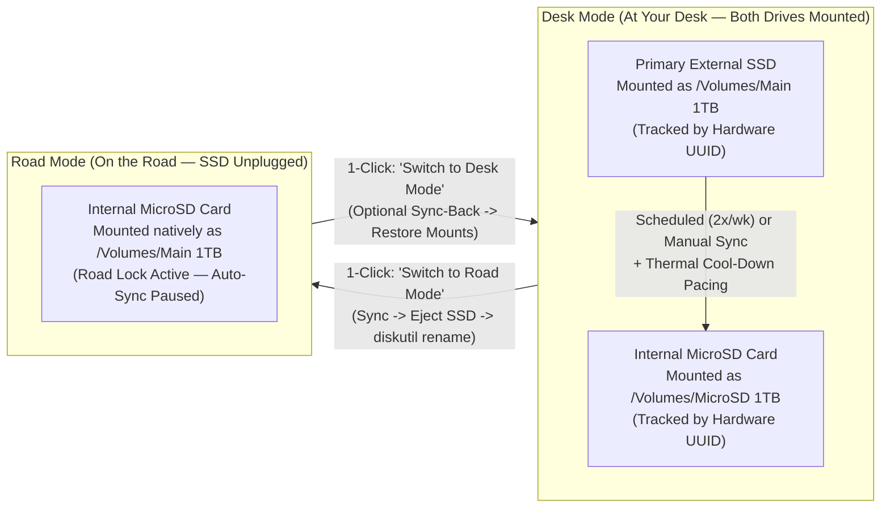

<div align="center">

# DiskTwin

**macOS Chameleon Volume Mirror for External SSD & Internal MicroSD**

[](LICENSE)
[-000000.svg)](#)
[](dist/DiskTwin-v1.1.0-macOS-arm64.dmg)

[**📥 Download DiskTwin v1.1.0 (.dmg Installer)**](https://github.com/SpaghettiRoads-lab/DiskTwin/raw/main/dist/DiskTwin-v1.1.0-macOS-arm64.dmg) • [**🌐 Interactive Web Showcase (GitHub Pages)**](https://spaghettiroads-lab.github.io/DiskTwin/)

</div>

---

## Why DiskTwin Exists

Developers, video editors, and AI engineers on MacBooks often keep their heavy workspaces (500 GB–1 TB+) on a fast portable **External USB/Thunderbolt SSD** (e.g., `/Volumes/Main 1TB`) to keep their internal MacBook SSD clean and half-empty.

However, carrying a dangling external SSD on the road—on flights, trains, or cafés—is cumbersome. Installing a **1TB MicroSD card** flush into the MacBook Pro's built-in SDXC slot provides effortless portability, **but introduces three classic macOS problems**:

1. **Broken Project & Tool Paths**: IDEs, Antigravity workspaces, Python `.venv` shebangs, Git submodules, and Final Cut / iMovie libraries all hardcode `/Volumes/Main 1TB/...`. When the external SSD is unplugged, every path breaks.
2. **MicroSD Thermal Runaway & SLC Cache Exhaustion**: Copying hundreds of gigabytes continuously to a 1TB microSD card ($11 \times 15\text{ mm}$) saturates its pseudo-SLC buffer and overheats the tiny controller inside the SDXC slot, causing severe throttling or surprise bus disconnects.
3. **Background Flash Wear & Accidental Overwrites**: macOS Spotlight (`mds_stores`) and `fseventsd` hammer SD cards with millions of random 4K writes, and naive scheduled backup scripts can overwrite files you edited on the road when you plug your External SSD back in.

**DiskTwin solves all three natively from the macOS Menu Bar.**

---

## Architecture & How It Works



### 1. UUID-Bound "Chameleon Mount" (Zero Broken Paths)
Instead of creating fragile symlinks inside `/Volumes` (which requires `sudo`, breaks realpath resolution in Node/Python, and causes macOS `diskarbitrationd` to mount your SSD as `/Volumes/Main 1TB 1`), DiskTwin tracks your two drives by their **immutable APFS Hardware Volume UUIDs**:
- **In Desk Mode**: Your External SSD is mounted at `/Volumes/Main 1TB`, and your MicroSD is mounted at `/Volumes/MicroSD 1TB`.
- **In Road Mode**: With a single click in the Menu Bar, DiskTwin runs an optional pre-flight incremental sync, safely ejects the External SSD, and executes `diskutil rename <MicroSD-UUID> "Main 1TB"`.
- macOS immediately mounts the MicroSD natively at **`/Volumes/Main 1TB`**. Every application on your Mac works seamlessly with zero path changes.

### 2. Hardware Block-Level Thermal & SLC Cache Pacing
Consumer 1TB 3D TLC/QLC microSD cards rely on a 15–35 GB pseudo-SLC cache. During large transfers:
- DiskTwin monitors **actual physical megabytes written** to the SDXC block device via `iostat -Id` (scanning unchanged files does not count toward the thermal budget).
- Every **35 GB** physically written (configurable from `15 GB` to `100 GB`), DiskTwin sends `SIGSTOP` to the `rsync` process group, flushes kernel buffers (`sync`), and pauses for **60 seconds** (`30–120s` configurable).
- This allows the microSD controller to fold its SLC cache into TLC/QLC blocks and drop $15\text{–}20^\circ\text{C}$ before resuming seamlessly via `SIGCONT`.

### 3. Zero-Wear Flash Safeguards
DiskTwin automatically applies and maintains:
- `.metadata_never_index` at the root of the MicroSD volume so macOS Spotlight never indexes 600,000+ files on flash storage.
- `.fseventsd/no_log` so macOS does not continuously write filesystem event logs to the SD card.
- Smart exclusion filters (`.Spotlight-V100`, `.Trashes`, `.fseventsd`, `.TemporaryItems`, `.DocumentRevisions-V100`, `.DS_Store`).

### 4. Road-Work Safety Lock (Two-Way Protection)
- The moment you switch to **Road Mode**, DiskTwin activates a persistent `road_lock` in `~/.disk-twin/state.json`.
- While `road_lock` is active, automatic scheduled `SSD → MicroSD` syncs are **hard-blocked**—even when you return home and plug your External SSD back in.
- Clicking **Switch to Desk Mode...** prompts you:
  1. **Sync Road Changes → Main SSD, then Switch**: Uses `rsync --update` (without `--delete`) so only files created or modified on the road are copied back to your External SSD, never deleting SSD-only files.
  2. **Switch Directly**: If you already pushed your road work via Git.

---

## Native macOS Menu Bar Interface

DiskTwin follows Apple's Human Interface Guidelines (HIG) using monochromatic vector template icons (`NSImage.isTemplate = true`) sourced from [21st.dev Community Icons](https://21st.dev/community/icons) that adapt automatically to Light Mode, Dark Mode, and translucent wallpapers:

| Menu Bar State | Indicator | Meaning |
| :--- | :--- | :--- |
| **Desk Mode** | `🖥 Desk` | External SSD is `/Volumes/Main 1TB`, MicroSD is `/Volumes/MicroSD 1TB` |
| **Road Mode** | `🧭 Road` | External SSD unplugged; MicroSD is mounted as `/Volumes/Main 1TB` (Road Lock Active) |
| **Syncing** | `↻ 42% (18.4G)` | Live transfer percentage and cumulative physical GB written in current session |
| **Cooling SD** | `⏳ Cool 48s` | `rsync` paused via `SIGSTOP` while MicroSD flushes SLC cache and cools down |
| **Attention** | `⚠ Plugged (Road)` | External SSD was reconnected while in Road Mode — click **Switch to Desk Mode...** |

### Settings Window (`⌘,`)
Click **Schedule & Thermal Cool-Down Settings...** in the Menu Bar dropdown to configure:
1. **Paired Volumes (Tracked by Hardware UUID)**: Select any mounted External SSD and Internal MicroSD/Mirror volume from live dropdowns.
2. **Automatic Background Sync Schedule**: Pick any combination of weekdays (**Mon–Sun**) and **Run Time (24h)** (updates `~/Library/LaunchAgents/com.antigravity.disktwin.plist` immediately).
3. **MicroSD Thermal Cool-Down & Wear Protection**:
   - **Cool-down break every**: `15 GB`, `25 GB`, `35 GB` *(Default)*, `50 GB`, `75 GB`, `100 GB`
   - **Cool-down pause duration**: `30s`, `45s`, `60s` *(Default)*, `90s`, `120s`
   - **Sustained write speed cap**: `Unlimited (Full Native Speed)` *(Default)*, `110 MB/s`, `90 MB/s`, `70 MB/s`, `50 MB/s`

---

## Installation

### Option A: `.dmg` Drag-and-Drop Installer (Recommended)
1. Download [**`DiskTwin-v1.1.0-macOS-arm64.dmg`**](https://github.com/SpaghettiRoads-lab/DiskTwin/raw/main/dist/DiskTwin-v1.1.0-macOS-arm64.dmg).
2. Open the `.dmg` and drag **`DiskTwin.app`** into **`Applications`**.
3. Launch **`/Applications/DiskTwin.app`**.
   - **Self-Bootstrapping**: On first launch, `DiskTwin.app` automatically creates `~/.disk-twin/`, installs `disk_twin.py` and vector icons on your internal drive (so the daemon never blocks unmounting external drives), initializes `config.json` and `excludes.txt`, and registers the `launchd` agents.
4. *(Recommended)* Install modern `rsync` (v3.4+) via Homebrew for accelerated `xxhash` delta transfers and real-time `--info=progress2` reporting:
   ```bash
   brew install rsync
   ```

### Option B: Build from Source
```bash
git clone https://github.com/SpaghettiRoads-lab/DiskTwin.git
cd DiskTwin
chmod +x ./build_dmg.sh
./build_dmg.sh
```

---

## Command-Line Interface (CLI)

In addition to the Menu Bar app, you can control DiskTwin from any terminal or script via `~/.disk-twin/disk_twin.py`:

```bash
# Inspect live hardware UUIDs, mount points, free space, and sync status
~/.disk-twin/disk_twin.py status

# Output full status as JSON
~/.disk-twin/disk_twin.py status --json

# List all mounted external/SD volumes and their APFS UUIDs
~/.disk-twin/disk_twin.py list-volumes

# Start a manual thermal-paced sync (Main 1TB -> MicroSD 1TB)
~/.disk-twin/disk_twin.py sync

# Stop a running sync cleanly (safe to resume later)
~/.disk-twin/disk_twin.py stop-sync

# Switch to Road Mode (sync recent changes first, eject SSD, rename MicroSD to Main 1TB)
~/.disk-twin/disk_twin.py to-road --sync-first

# Quick Switch to Road Mode without running a sync first
~/.disk-twin/disk_twin.py to-road

# Return to Desk Mode and sync newer Road Mode files back to the External SSD
~/.disk-twin/disk_twin.py to-desk --sync-back
```

---

## License

Released under the [**MIT License**](LICENSE) — free for personal, academic, and commercial use.
